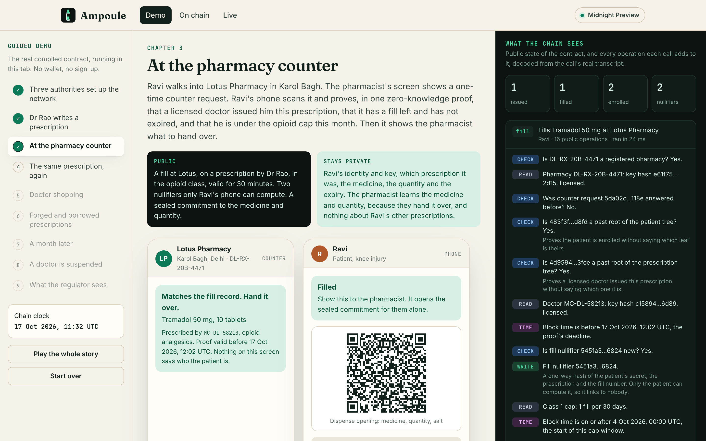
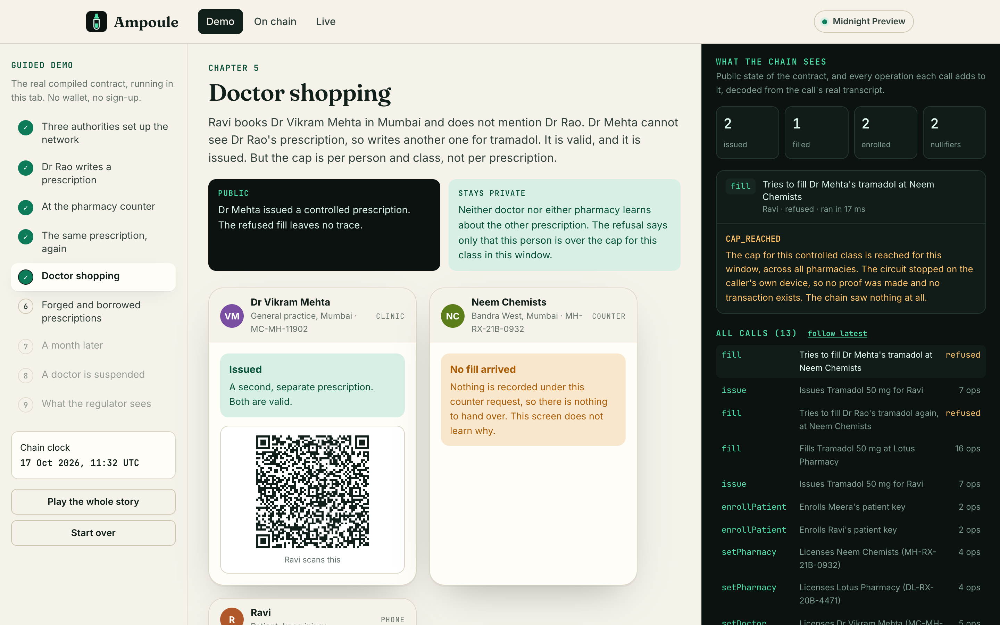
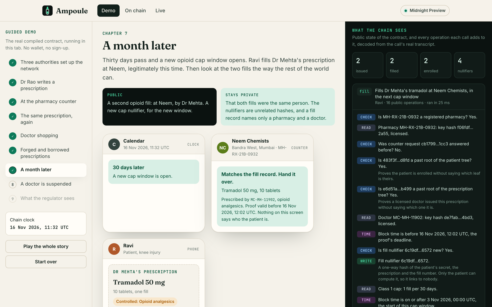
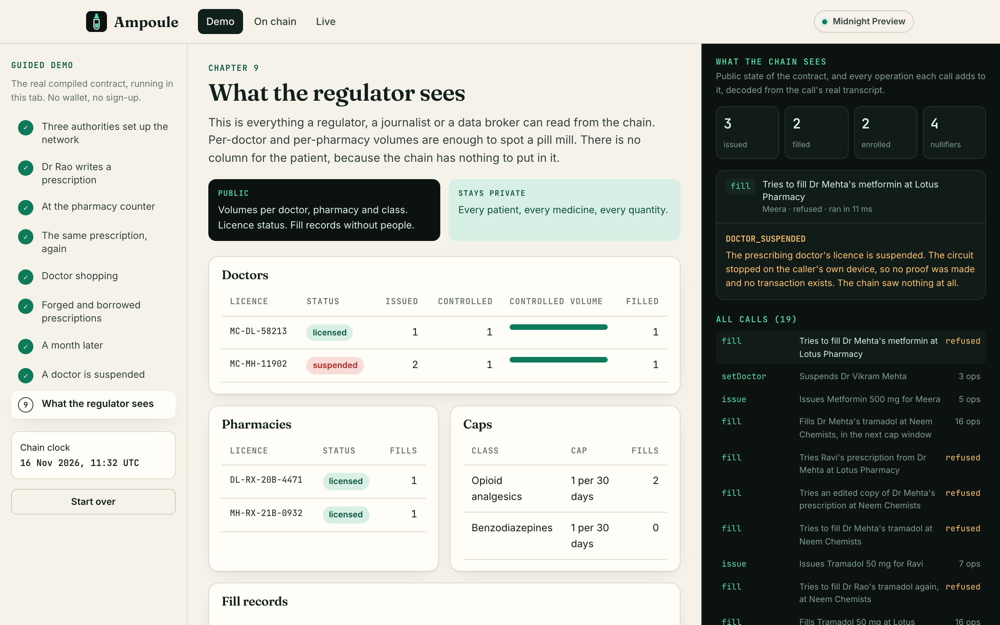
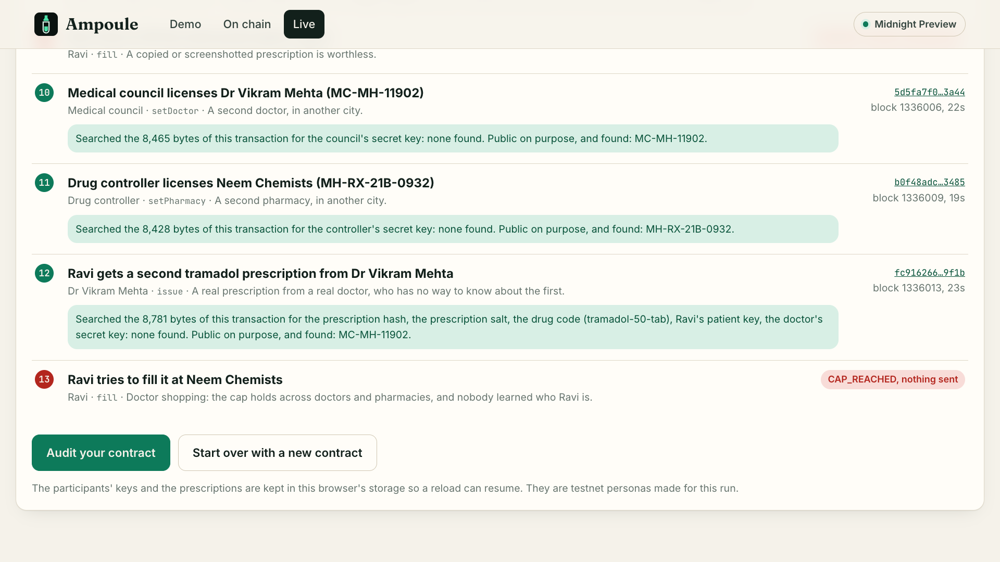
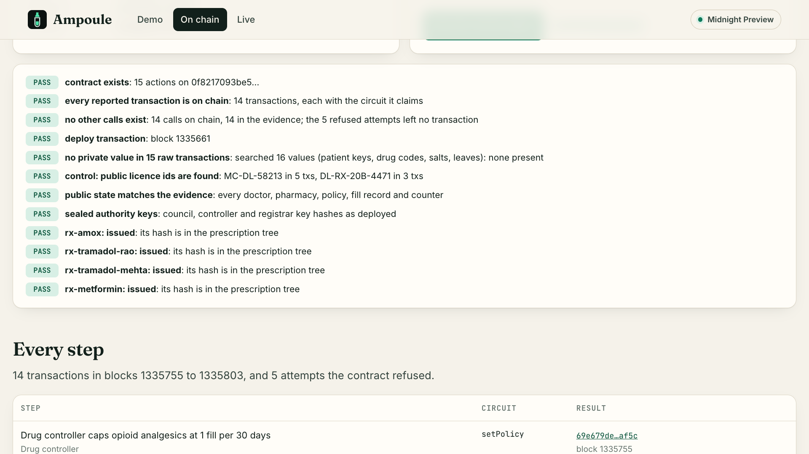
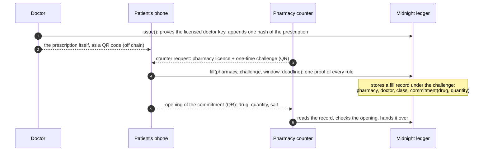

# Ampoule

[](https://github.com/Sanchay117/ampoule/actions/workflows/ci.yml) [](https://midnight.network) [](contract/src/ampoule.compact) [](LICENSE)

**Sealed prescriptions on Midnight.** One prescription, one fill. Monthly caps on opioids and other controlled drugs that hold across every doctor and every pharmacy. And no patient data on chain.

**[Guided demo](https://sanchay117.github.io/ampoule/#/demo)** (runs in your browser, no wallet) · **[Live with Lace](https://sanchay117.github.io/ampoule/#/live)** · **[On Midnight Preview](https://sanchay117.github.io/ampoule/#/ledger)** · **[The contract](contract/src/ampoule.compact)** · **[For judges](JUDGES.md)** · [Privacy boundary](docs/PRIVACY-BOUNDARY.md) · [Threat model](docs/THREAT-MODEL.md) · [Adoption](docs/ADOPTION.md)



## The problem

A prescription for a controlled drug is two things at once. It is a medical record that should stay between a patient, a doctor and a pharmacist. It is also a claim on a supply that is easy to abuse and that society wants to police.

Paper and PDF prescriptions fail the second test. They are copied, edited and filled twice, and a patient who sees three doctors can fill three opioid prescriptions at three pharmacies without any of them knowing. The usual fix, a central prescription monitoring database, fails the first test. It is a named register of everyone on painkillers, sedatives or ADHD medication, queried at every pharmacy counter and kept indefinitely.

Ampoule gets the policing without the register.

## What it guarantees

| Rule | Enforced by |
|---|---|
| A prescription fills at most as many times as the doctor wrote | A fill nullifier, `H(patient secret, prescription, fill number)`, that can be spent once |
| At most N fills of a controlled class per person per 30 days, from any doctor at any pharmacy | A cap nullifier, `H(patient secret, class, window, slot)`, one per slot per window |
| Only a licensed doctor can issue, and only the named patient can fill | Doctor key hashes registered by a medical council; prescriptions bound to the patient's key |
| Forged or edited prescriptions are worthless | The fill proves the prescription's hash is in the tree only doctors can append to |
| Suspending a doctor stops every open prescription they wrote, everywhere, at once | The fill reads the prescriber's licence status |
| The pharmacist hands over exactly what was prescribed | The fill record commits to drug and quantity; the patient's phone opens it for the pharmacist |

What the chain never sees: who the patient is, the drug, the quantity, the expiry date, or anything that links two fills by the same person. Refused attempts never reach the chain at all, because the proof cannot be built.

## Who it is for

Regulators set controlled-drug rules and pharmacies carry them out. Ampoule gives the regulator (a state drug controller or a medical council) live public counts and suspensions that take effect everywhere at once. It gives the pharmacy one check at the counter that covers every other pharmacy. And it gives the patient a prescription that only the people treating them can read. In India it would replace the Schedule H1 register every pharmacy keeps today: a paper record of the patient's name, the drug and the quantity for every listed sale, which no other pharmacy can see. The registrar already exists: 79.71 crore ABHA health IDs had been created by July 2025. [docs/ADOPTION.md](docs/ADOPTION.md) has the adoption path, the business model and the sources.

## Try it

**In your browser.** The [guided demo](https://sanchay117.github.io/ampoule/#/demo) walks through nine chapters: setting up the network, a prescription, a fill at the counter, a second fill of the same prescription, doctor shopping, a forged and a borrowed prescription, a new cap window, a suspended doctor, and the regulator's view. Every button runs the compiled contract in your tab on the Compact runtime, through the same SDK the CLI uses on Preview. Beside it, a dark panel decodes each call's public transcript into plain English and searches it for every private input that call used. It never finds one. It does find the pharmacy's licence number, which is public on purpose, so you can see the search works.

| Doctor shopping, refused | Two fills, one person, nothing linking them | What a regulator can read |
|---|---|---|
|  |  |  |

**Live, with your wallet.** The [live page](https://sanchay117.github.io/ampoule/#/live) connects Lace (DApp Connector API 4) on Preview, deploys your own copy of the contract and runs the core of the story with real proofs: 10 transactions your wallet balances and submits, and two attempts refused in the browser before anything is sent. After each transaction it downloads the raw bytes from the indexer and searches them for that step's private values, and at the end it runs the full audit on your contract. Without Lace, `npm run cli -- bridge` lends the page the CLI's funded wallet.

**On Midnight Preview.** The CLI runs the same story on the public testnet with real zero-knowledge proofs. The [on-chain page](https://sanchay117.github.io/ampoule/#/ledger) lists every transaction with explorer links, and its "Run the checks" button downloads every raw transaction of the contract from the public indexer and runs the same audit as `npm run cli -- verify`, in your browser.

| The live page, after a run on Preview | The public audit of the reference deployment |
|---|---|
|  |  |

## How it works



1. **Issue.** The doctor's app proves, inside the `issue` circuit, that it holds the secret whose hash the medical council registered for this licence number. It appends `H(prescription)` to a historic Merkle tree. The prescription (patient key, drug, quantity, class, fills, expiry, random salt) goes to the patient as a QR code, like a paper slip.
2. **Fill.** At the counter the pharmacy shows a QR with its licence number and a fresh challenge. The patient's phone proves in one transaction: the patient is enrolled (patient tree membership), the prescription is in the issued tree and names this patient, its doctor is still licensed, it has not expired, this fill number is unused, and for a controlled class, this person's cap for the current window is not used up. Only the two nullifiers and a fill record are written.
3. **Dispense.** The fill record stores a commitment to the drug and quantity. The phone shows the pharmacist the opening; the pharmacy checks it against the record and hands over exactly that.

### The contract

[`contract/src/ampoule.compact`](contract/src/ampoule.compact), Compact language 0.23, compiled with compactc 0.31.1.

| Circuit | Caller proves | Published |
|---|---|---|
| `setDoctor(id, keyHash, active)` | the medical council's secret | licence id, key hash, status |
| `setPharmacy(id, keyHash, active)` | the drug controller's secret | licence id, key hash, status |
| `setPolicy(class, window, maxFills)` | the drug controller's secret | the cap for a controlled class |
| `enrollPatient(patientKey)` | the registrar's secret | a hash of the patient key, as a tree leaf |
| `issue()` | the doctor's secret for a licensed, active id | doctor id, drug class, a hash of the prescription hash |
| `fill(pharmacy, challenge, epoch, validBefore)` | everything in step 2 above | pharmacy, challenge, window number, a 30-minute deadline, past tree roots, doctor id, class, two nullifiers, a commitment to drug and quantity |

Every value that reaches the ledger passes through `disclose()` in the source, so this table can be checked line by line. [docs/PRIVACY-BOUNDARY.md](docs/PRIVACY-BOUNDARY.md) does that for each circuit. Authorization is always proof of a secret whose hash is on the ledger, never the fee-paying wallet, so the wallet that pays links nothing to anyone.

Every refusal has a code, and the demo and the CLI show it: `ALREADY_FILLED`, `CAP_REACHED`, `NO_SUCH_PRESCRIPTION`, `NOT_YOUR_PRESCRIPTION`, `DOCTOR_SUSPENDED`, `PRESCRIPTION_EXPIRED`, `CHALLENGE_USED` and 15 more in [`refusals.ts`](contract/src/refusals.ts).

### Time

The proof never contains the expiry date. The patient's phone picks `validBefore`, a deadline at most 30 minutes ahead, and the circuit proves `blockTime < validBefore <= notAfter`. For a capped class it also proves the deadline falls inside the current 30-day window, so a proof made at the end of one window cannot spend the next one. The window number is public; it is the current time, rounded to 30 days.

## Evidence that it is private

1. **Contract tests** decode the public transcript of every circuit and assert what is and is not in it ([`privacy.test.ts`](contract/test/privacy.test.ts)): issuing reveals the doctor, the class and one hash; filling never reveals the patient key, the prescription hash, the drug, the expiry or any secret; two fills by one person share nothing that fills by two people do not; refused attempts leave no trace.
2. **The demo** searches every transcript it produces for that call's private inputs, live, and the end-to-end tests fail if it ever finds one.
3. **The Preview audit.** The scenario's evidence file discloses the testnet demo's private values (patient keys, drug codes, salts, prescription hashes) so that anyone can search the chain for them. `npm run cli -- verify` (or the button on the on-chain page) downloads every raw transaction of the contract and finds none of them, while finding the licence numbers that are public by design.

## Run it

Needs Node 22 or newer. Compact 0.31.1 is only needed to recompile the contract, and Docker only to make real proofs.

```bash
npm install
npm test            # 52 contract tests and 25 SDK tests
npm run dev         # the site, on http://localhost:5199
```

```bash
npm run -w web e2e  # Playwright: every demo chapter, desktop and phone
npm run compile     # recompile the contract and its proving keys (compactc 0.31.1)
```

### On Midnight Preview

```bash
docker compose -f proof-server.yml up -d   # proof server 8.1.3 on :6300
npm run cli -- wallet new                  # prints an address to fund
# fund it at https://faucet.preview.midnight.network/
npm run cli -- wallet status               # syncs, registers tNIGHT for DUST
npm run cli -- deploy                      # one transaction, six verifier keys
npm run cli -- scenario                    # the story, with real proofs; resumable
npm run cli -- verify                      # the public audit; needs no wallet
npm run cli -- bridge                      # lends the wallet to the live page on localhost
```

The live page needs the proving keys in `web/public/zk/`: `npm run compile && npm run -w web zk:stage`. The Pages build does this.

Secrets (the wallet mnemonic, the demo's authority keys) are written to `cli/.secrets/`, which is git-ignored. The deployment and evidence files in `cli/deployments/` and `cli/evidence/` are committed.

## Repository

| Path | What |
|---|---|
| [`contract/`](contract) | The Compact contract, witnesses, a simulator, refusal codes, and the tests: lifecycle, every refusal, privacy, and a model-based property test of random histories |
| [`sdk/`](sdk) | One client per participant (council, controller, registrar, doctor, pharmacy, patient), the QR token codecs, the transcript decoder, the public view, the audit, and two backends: in-memory and Midnight network |
| [`cli/`](cli) | Headless wallet, deploy, the resumable on-chain scenario, `verify`, and the wallet bridge |
| [`web/`](web) | The site: landing page, guided demo, live page with Lace, on-chain page, Playwright tests |
| [`docs/`](docs) | Privacy boundary, threat model, adoption path, and the pitch deck ([`docs/deck`](docs/deck), rendered to [`Ampoule-deck.pdf`](docs/Ampoule-deck.pdf)) |
| [`video/`](video) | The demo video as scripts: narration, a Playwright recording of the real site (the live scenes run on Preview), and the ffmpeg edit |

Built with compactc 0.31.1, `@midnight-ntwrk/compact-runtime` 0.16.0, ledger v8, midnight-js 4.1.1, wallet-sdk 1.2.0 and proof server 8.1.3, as listed in Midnight's compatibility matrix for Preview.

## Limits

- **One key per person is the registrar's job.** The chain enforces one cap per enrolled key. A registrar that enrolls the same person twice gives them two caps. In practice the registrar is a health-ID authority that already deduplicates people.
- **Lost phones.** The patient secret lives on the phone. The registrar can enroll a new key, but the contract has no revocation for the old one, and prescriptions bound to it must be reissued.
- **Small networks leak by size.** The class, the prescriber and the pharmacy of every fill are public, on purpose, so regulators can see per-doctor volumes. With few users, that can narrow down who filled what. Unlinkability grows with the number of people filling.
- **A deadline that equals the expiry.** `validBefore` is the earliest of now plus 30 minutes, the window end and the expiry. A prescription filled in its last 30 minutes therefore publishes its exact expiry. Rounding the deadline would close this.
- **The guided demo does not prove.** It runs the same compiled circuits on the Compact runtime and shows their real transcripts, but zero-knowledge proofs need a prover. The live page and the CLI make real proofs on Preview.
- **The live page keeps its testnet personas in the browser.** Every participant's key is made in the visitor's browser and kept in its storage so a run can resume. A real deployment gives each person their own device.
- **People see what their role needs.** The doctor sees what they prescribe and the pharmacist sees what they hand over. That is the point of a prescription.

## Roadmap

**Wave 2, this submission.** The contract and its tests, the SDK, the CLI and the Preview deployment, and the site: the guided demo, the live page with Lace, and the on-chain audit.

**Wave 3, 27 October to 16 November.** Make it usable at a real counter.

- A patient wallet that installs as a web app: prescriptions kept offline, key backup, fills proved in the wallet.
- A counter page with camera scanning, and the pharmacy's log of the challenges it has dispensed against (see "Filling ahead of time" in the [threat model](docs/THREAT-MODEL.md)).
- Fees paid by the pharmacy, so that no wallet links one patient's fills.
- Contract changes from the threat model: patient key rotation, a rounded deadline to close the expiry edge case, and deeper trees.

**After the buildathon.** A pilot with one hospital and the pharmacies around it, for one or two controlled classes. Then integrations with e-prescription and pharmacy billing software. See [docs/ADOPTION.md](docs/ADOPTION.md).

## License

Apache-2.0. All people, clinics and pharmacies in the demo are fictional.

Built on [Midnight](https://midnight.network) with the [Compact](https://docs.midnight.network/) language and the Midnight TypeScript SDKs.
